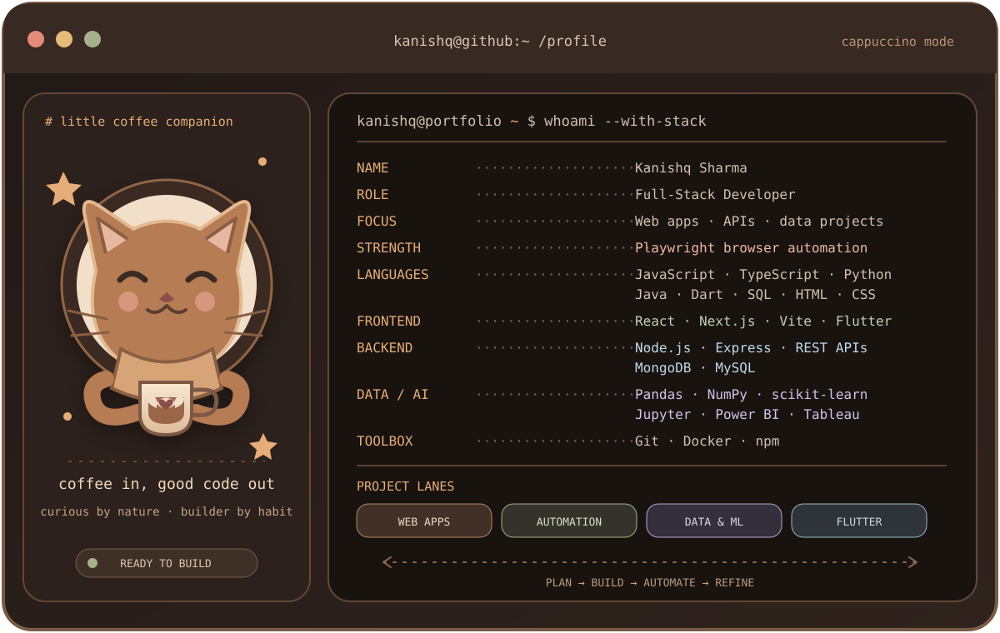

 

## 👋 About Me

I enjoy turning ideas into practical software: interactive web applications, APIs, automation workflows, and data projects. I work across frontend and backend development and keep expanding my toolkit through hands-on projects.

**A key strength:** Playwright browser automation. I focus on reliable end-to-end workflows that follow real user journeys, validate behavior, and reduce repetitive manual steps.

| ✨ Building | 🧪 Automating | 📊 Exploring |
|:---:|:---:|:---:|
| Full-stack applications and APIs | Playwright workflows and browser testing | Data analysis and machine learning |

## 🧰 Technology Stack

### Languages

### Frameworks and Platforms

### Data, Automation, and Tools

## 🚀 Featured Projects

<table>
  <tr>
    <td width="50%">
      <h3><a href="https://github.com/Kanishq10/Toque_chef_hire">🍽️ Toque Chef Hire</a></h3>
      
A React Router marketplace application for discovering chef services and managing hiring workflows.

      <code>React Router</code> <code>TypeScript</code> <code>Tailwind CSS</code> <code>Docker</code>
    </td>
    <td width="50%">
      <h3><a href="https://github.com/Kanishq10/MetaTransfer-Frontend">🔁 MetaTransfer</a></h3>
      
A React client for a transfer-management product, paired with a separate Node.js backend.

      <code>React</code> <code>Node.js</code> <code>Express</code> <code>MongoDB</code>
    </td>
  </tr>
  <tr>
    <td width="50%">
      <h3><a href="https://github.com/Kanishq10/NextJS_shadcn_Dashboared">📊 Next.js Dashboard</a></h3>
      
A reusable dashboard interface built with a modern Next.js application structure.

      <code>Next.js</code> <code>TypeScript</code> <code>Tailwind CSS</code>
    </td>
    <td width="50%">
      <h3><a href="https://github.com/Kanishq10/Netflix_content_analysis">🎬 Netflix Content Analysis</a></h3>
      
A notebook workflow for preparing, exploring, visualizing, and modeling a titles dataset.

      <code>Python</code> <code>Pandas</code> <code>Jupyter</code>
    </td>
  </tr>
  <tr>
    <td width="50%">
      <h3><a href="https://github.com/Kanishq10/world_time_flutter">🌍 World Time</a></h3>
      
A Flutter application presenting world-time information in a cross-platform interface.

      <code>Flutter</code> <code>Dart</code> <code>REST APIs</code>
    </td>
    <td width="50%">
      <h3><a href="https://github.com/Kanishq10/Bubble-Sort-Visualiser">🫧 Bubble Sort Visualiser</a></h3>
      
A browser-based visualization of sorting progress and algorithm state.

      <code>JavaScript</code> <code>HTML</code> <code>CSS</code>
    </td>
  </tr>
</table>

## 🤖 Automation and Developer Utilities

- [HackerRank Automation](https://github.com/Kanishq10/HackerRank-Automation) and [Async/Await Automation](https://github.com/Kanishq10/HackerRankAutomationAsyncAwait) — browser automation experiments
- [GitHub Scraper](https://github.com/Kanishq10/Github_Scrapper) — collects GitHub topic and issue information
- [File Organiser](https://github.com/Kanishq10/FileOrganiser) — a Node.js command-line utility for file workflows

## 📚 Learning Archives

- [Data Science Practice](https://github.com/Kanishq10/Data_Science_Practice) — Python, statistics, SQL, and visualization
- [Machine Learning Projects](https://github.com/Kanishq10/Machine_Learning_Projects) — regression and classification experiments
- [ML Projects](https://github.com/Kanishq10/ML-_Projects) — notebooks spanning several modeling approaches
- [DSA](https://github.com/Kanishq10/DSA) — Java data structures and algorithm exercises
- [LeetCode Submissions](https://github.com/Kanishq10/Leetcode-submissions) — problem-solving implementations
- [Developer Archive](https://github.com/Kanishq10/Dev-Archive) — experiments across languages and frameworks

## 📈 GitHub Graphs

 

## 🎖️ Holopin Badges

 

Made with curiosity, code, and a little cappuccino ☕

