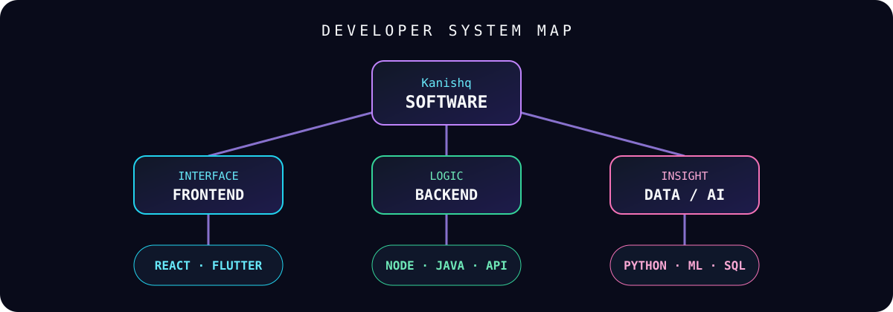

<picture>
  <source media="(prefers-color-scheme: dark)" srcset="./assets/header.svg"/>
  
</picture>

 

## 👋 About

I am a software developer building across the full stack, with hands-on work in JavaScript, TypeScript, Java, Python, Flutter, data science, and automation.

My repositories explore practical application development, REST APIs, modern web interfaces, browser automation, data analysis, machine-learning workflows, and cross-platform mobile experiences.

<table>
  <tr>
    <td><b>Focus</b></td>
    <td>Full-stack development, API architecture, automation, data analysis, and machine learning</td>
  </tr>
  <tr>
    <td><b>Working with</b></td>
    <td>React, Next.js, Node.js, Express, Flutter, Python, Java, and SQL</td>
  </tr>
  <tr>
    <td><b>Approach</b></td>
    <td>Build practical projects, study core concepts, and improve them through iteration</td>
  </tr>
  <tr>
    <td><b>Portfolio</b></td>
    <td>Application projects, analysis notebooks, learning archives, and coding exercises</td>
  </tr>
</table>

  <picture>
    <source media="(prefers-color-scheme: dark)" srcset="./assets/system-map.svg"/>
    
  </picture>

## 🧰 Technology

### Languages

### Frameworks and Platforms

### Data, AI, and Developer Tools

## 🚀 Featured Work

<table>
  <tr>
    <td width="50%">
      <h3><a href="https://github.com/Kanishq10/Toque_chef_hire">Toque Chef Hire</a></h3>
      
React Router marketplace application for discovering chef services and managing hiring workflows.

      
<code>React Router</code> <code>TypeScript</code> <code>Tailwind CSS</code> <code>Docker</code>

    </td>
    <td width="50%">
      <h3><a href="https://github.com/Kanishq10/MetaTransfer-Frontend">MetaTransfer Frontend</a></h3>
      
React client interface for a transfer-management application with modular UI and state flows.

      
<code>React</code> <code>JavaScript</code> <code>REST API</code> <code>CSS</code>

    </td>
  </tr>
  <tr>
    <td width="50%">
      <h3><a href="https://github.com/Kanishq10/MetaTransfer-Backend">MetaTransfer Backend</a></h3>
      
Node.js REST backend organized around routes, controllers, middleware, and data models.

      
<code>Node.js</code> <code>Express</code> <code>MongoDB</code> <code>REST API</code>

    </td>
    <td width="50%">
      <h3><a href="https://github.com/Kanishq10/NextJS_shadcn_Dashboared">Next.js Dashboard</a></h3>
      
Modern dashboard interface built with Next.js, reusable components, and responsive layouts.

      
<code>Next.js</code> <code>TypeScript</code> <code>Tailwind CSS</code>

    </td>
  </tr>
  <tr>
    <td width="50%">
      <h3><a href="https://github.com/Kanishq10/Netflix_content_analysis">Netflix Content Analysis</a></h3>
      
End-to-end notebook project covering data preparation, exploration, visualization, and modeling.

      
<code>Python</code> <code>Pandas</code> <code>Jupyter</code> <code>Machine Learning</code>

    </td>
    <td width="50%">
      <h3><a href="https://github.com/Kanishq10/world_time_flutter">World Time Flutter</a></h3>
      
Cross-platform Flutter application presenting world-time information through a responsive interface.

      
<code>Flutter</code> <code>Dart</code> <code>REST API</code> <code>Cross-platform</code>

    </td>
  </tr>
</table>

## 📚 Learning and Problem Solving

- [DSA](https://github.com/Kanishq10/DSA) — Java implementations for algorithms and data structures
- [LeetCode Submissions](https://github.com/Kanishq10/Leetcode-submissions) — Recorded solutions and problem-solving patterns
- [Machine Learning Projects](https://github.com/Kanishq10/Machine_Learning_Projects) — Regression and classification experiments
- [Data Science Practice](https://github.com/Kanishq10/Data_Science_Practice) — Python, statistics, SQL, visualization, and data workflows
- [Developer Archive](https://github.com/Kanishq10/Dev-Archive) — Broad collection of experiments across languages and frameworks

## 📊 GitHub Analytics

 

## 🏆 Achievements

 

  <picture>
    <source media="(prefers-color-scheme: dark)" srcset="./assets/footer.svg"/>
    
  </picture>

