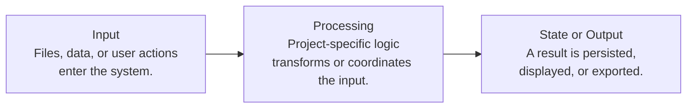

# Kanishq10

A software project demonstrating a practical implementation and project workflow.

## Overview

This repository is maintained as a learning project or technical archive. It documents an implementation area, a set of practical exercises, or an experiment while preserving a focused and inspectable project structure.

## Key Features

- Self-contained implementation
- Browser or tool-based interaction
- Reusable project structure
- Clear input-to-output workflow

## Technology Stack

| Area | Technology |
|---|---|
| Library / Framework / Tool | Repository-specific tooling |

## Architecture and Data Flow

| Stage | Responsibility |
|---|---|
| **Input** | Files, data, or user actions enter the system. |
| **Processing** | Project-specific logic transforms or coordinates the input. |
| **State or Output** | A result is persisted, displayed, or exported. |

## Setup

1. Review the repository structure and applicable runtime requirement.
2. Open the entry-point file in an editor or IDE.
3. Run or open it using the tool required for the project language.

## Usage

Run the repository entry point using the language or platform documented in the setup section.

## Configuration

No mandatory repository-specific configuration is documented by the project structure. Environment or runtime options may be defined inside the relevant entry-point file or platform settings.

## Verification

- Run the project entry point and verify the primary success and error paths.
